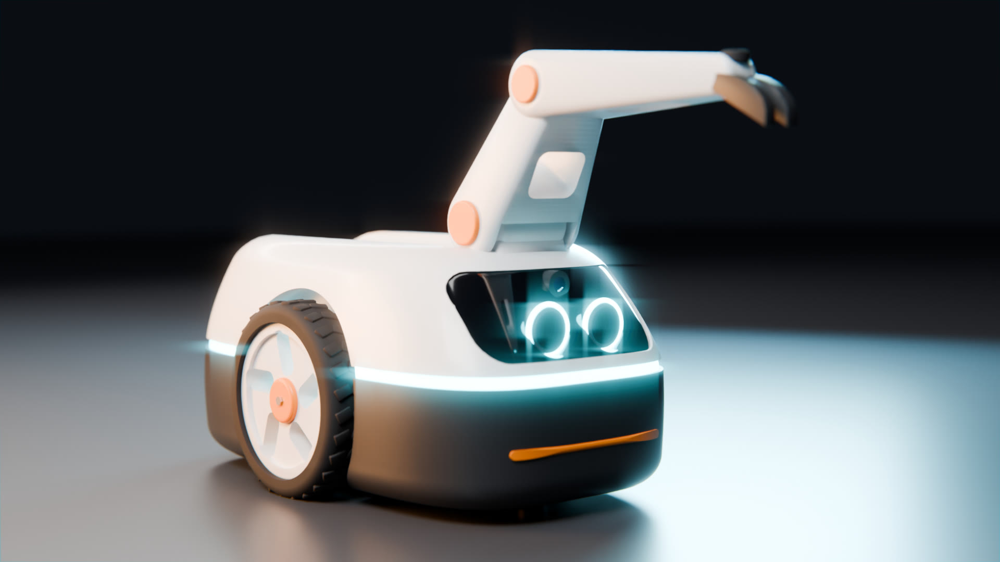
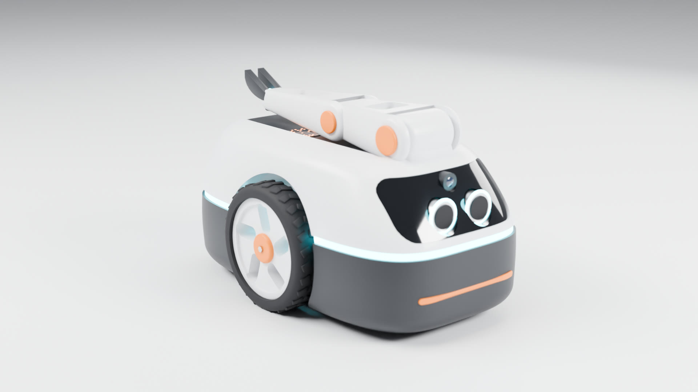
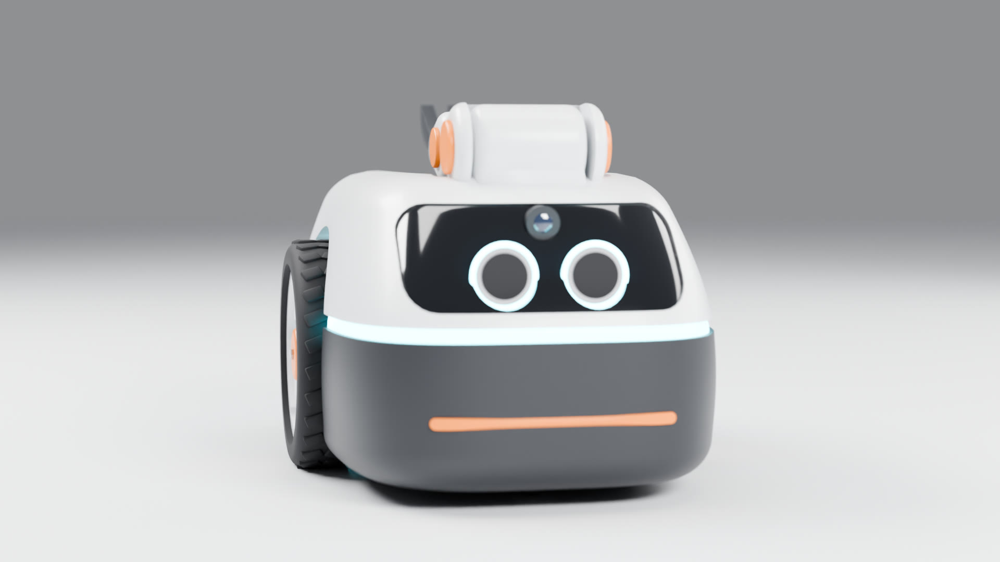
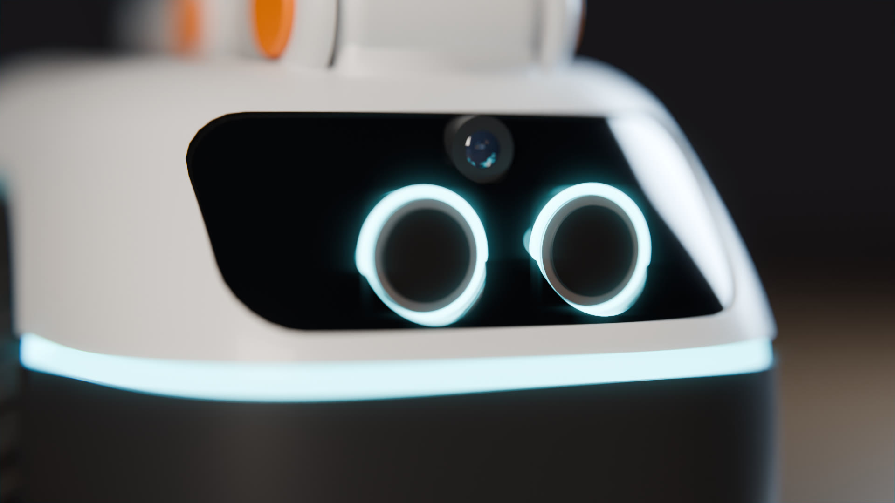
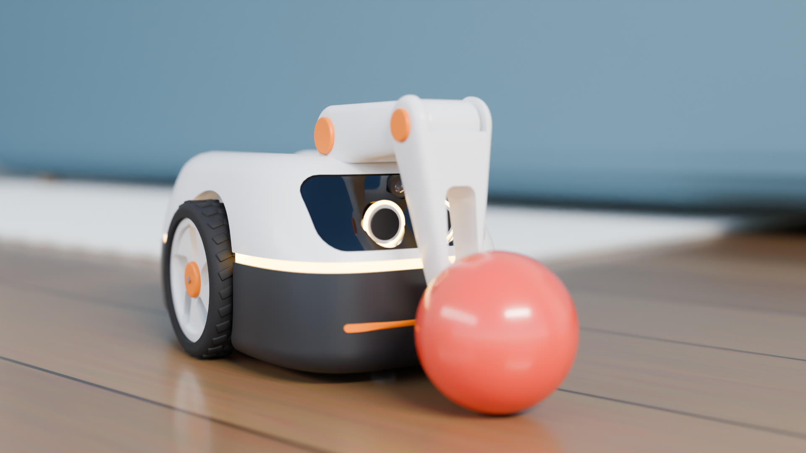
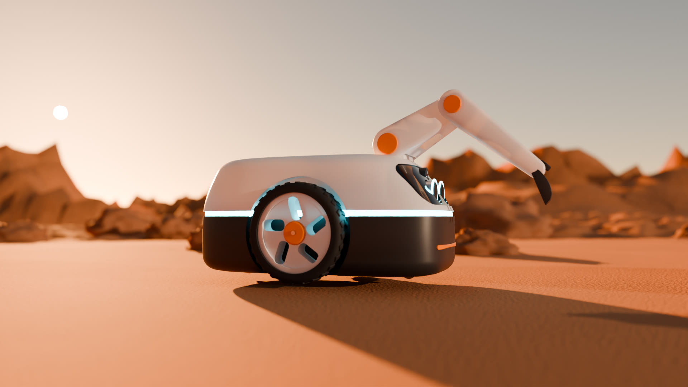
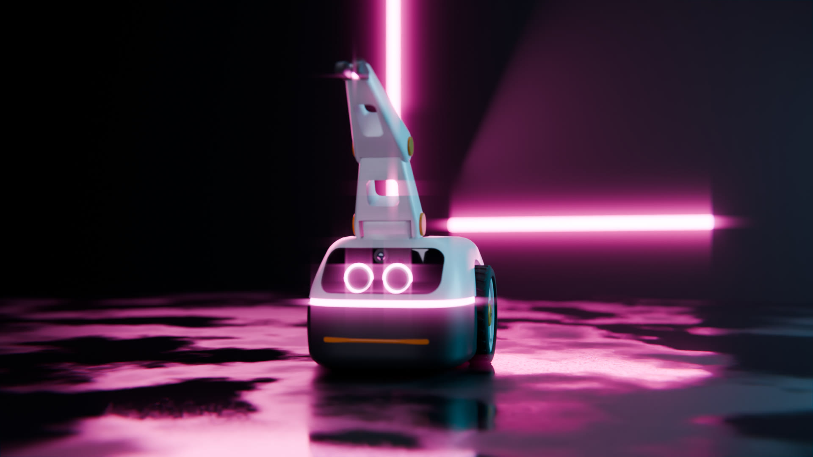
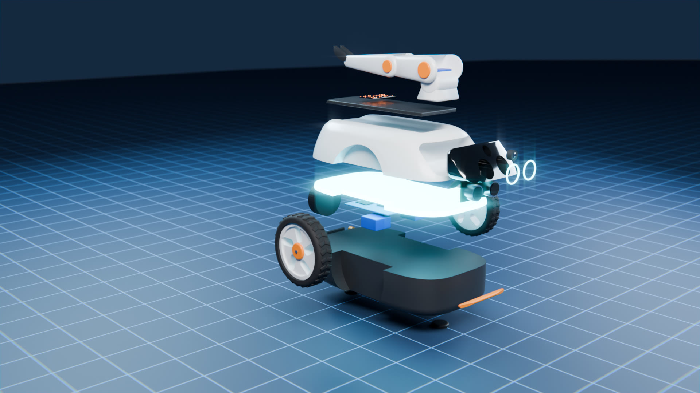
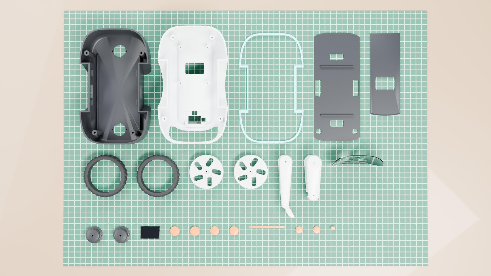
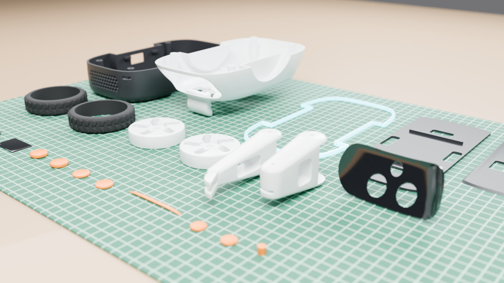

# NOVA: the AGI Robot redesign (v2)

NOVA is a new body for the same robot. It uses the same electronics (Arduino Uno Q, 4 x SG90, HC-SR04, USB webcam,
mini speaker, RGB LED, 10000 mAh power bank). The boxy chassis and cabin are replaced by a rounded two-tone shell. The
2-DOF arm now folds into a bay in the roof.

Everything is generated procedurally from Python in Blender 5.2, so every render, animation and STL can be rebuilt from
the scripts in [`/blender`](../blender).



## Design

| | |
|---|---|
| Size (parked) | 205 x 132 x 112 mm (L x W x H), roof at 94 mm |
| Drive | 2 x SG90 360° in the middle (differential drive, turns on the spot), 2 x 12 mm ball casters |
| Wheels | 72 mm, PLA 5-spoke rim + TPU chevron tire, mounted on the round SG90 horn |
| Face | Gloss-black visor. The HC-SR04 transducers are the "eyes" (66 mm high), the webcam lens is above them (80 mm) |
| Mood ring | Translucent PETG band between the graphite tub and the white canopy, lit by the RGB LED |
| Arm | Shoulder SG90 in a pod on the front of the roof, elbow SG90 inside the upper arm, 55 + 88 mm links, fixed hook-claw |
| Roof | Arm bay (graphite tray). The smoked window shows the Uno Q LED matrix, which is mounted under the bay |

**Arm convention** (firmware, Python and Blender all use the same numbers):

* `arm1` (shoulder): `0` folded back into the roof bay, `90` straight up, `180` forward
* `arm2` (elbow): `180` straight, `90` right angle (points at the floor when `arm1 = 180`), minimum `20`
* Reach: the claw touches the floor 2-5 cm in front of the bumper (`arm1 = 180`, `arm2 = 90...110`), which is
  inside the camera view.

| | | |
|---|---|---|
|  |  |  |
|  |  |  |
|  |  |  |

## Printing

The STLs are in [`/3d/nova`](../3d/nova). They are already in print orientation and sit on z = 0. The old parts in
`/3d` are left untouched. Each part's volume and bounding box are in [`print_report.md`](../3d/nova/print_report.md).

| Part | Qty | Filament | Notes |
|---|---|---|---|
| Tub | 1 | PLA graphite | open side up, no supports. 4 M3 counterbores underneath |
| Canopy | 1 | PLA pearl white | roof down. Tree supports for the shoulder pod and visor opening |
| MoodRing | 1 | PETG clear / natural | 4 mm band that sits between tub and canopy |
| Visor | 1 | PETG black / smoke | glue in behind the canopy opening (3 mm lip) |
| BayTray, Deck | 1 + 1 | PLA graphite | Deck rests on 4 ribs above the drive servos and has a breadboard fence |
| MatrixWindow | 1 | smoke PETG or 1.2 mm acrylic | |
| Link1, Link2 | 1 + 1 | PLA pearl white | print on their side. Supports in the servo pockets |
| Rim / Tire / HubCap | 2 / 2 / 2 | PLA white / TPU 95A / PLA orange | |
| Caster | 2 | any | pause at z = 9.8 mm and drop in a 12 mm steel ball |
| JointCapL / JointCapS, ChinInlay, RearButton | 2 / 2 / 1 / 1 | PLA orange | cosmetic, glue on |

Budget: about 250 g of filament.

### Assembly

1. **Tub**: push the two 360° SG90s through the slots in the wheel-arch walls (shaft facing out) and screw them with
   the tab screws. Snap the ball casters in from below (2 x M2). Slide the power bank between the floor rails.
2. **Wheels**: screw the round servo horn into the rim recess. The centre screw goes through the dish and is hidden
   by the hub cap. Stretch the TPU tire on.
3. **Deck**: lay it on the 4 ribs, put the breadboard inside the fence, and route cables through the slots.
4. **Canopy**: screw the Uno Q (M2.5 x 6) to the 4 standoffs under the bay so that the LED matrix lines up with the
   window. Slide the shoulder SG90 up into the pod from inside (shaft out on the right) and fix it with a drop of hot
   glue. Glue in the visor, press the HC-SR04 transducers into the eye holes and fix the webcam behind the lens hole.
5. **Arm**: put the shoulder horn into the recess of Link1. Link1's left side pivots on an M3 screw into the pod. Put
   the elbow SG90 into Link1 from below, and mount Link2 the same way (horn on the right, M3 pivot on the left).
   **Set both servos to the parked pose (`arm1 = 0`, `arm2 = 180`) before you attach the horns.**
6. **Close**: put the mood ring on the tub, place the canopy on top, and drive 4 x M3 x 16 screws up from the
   bottom. The RGB LED sits just inside the ring.

> These parts have not been test-printed yet. Before you print the big shells, check the tolerances for the SG90
> pockets (0.3 mm clearance) and the Uno Q hole pattern against your own board.

## Software changes

* `sketch/sketch.ino`: the arm moves smoothly (smoothstep easing, about 125°/s) instead of snapping, which used to
  jerk the light body and could brown out the power bank. Added `armPose("a1,a2,ms")`. The robot now starts parked.
  The forward obstacle stop is lowered to 4 cm so that the arm can reach objects.
* `python/arm_skills.py` (new): named arm skills that match the NOVA kinematics: `park, raise, look_around,
  point_forward, hover, reach_floor, tap, flick, scoop, push_ready, wave, nod, shrug, celebrate`. It also checks
  forward kinematics, so the claw is never driven into the body or the floor.
* `python/main.py`:
  * The arm folds automatically before driving.
  * A forward move is clamped to the measured free space minus 5 cm, so the robot can no longer drive into an
    obstacle, even if the LLM asks it to.
  * Short-term episodic memory: the last 12 cycles (what it saw, did, said, and whether a move was blocked) go
    into every prompt.
  * `movement_history` is capped at 30 entries. Before, it grew forever and bloated the prompt.
* `python/media_service.py`: the main model is now **`gemini-4-hydrogen`** (Gemini 4 Flash tier) with `thinking_level=medium`. The model can be overridden with the env vars `LLM_MODEL`, `LLM_MODEL_ASI` and `LLM_THINKING_LEVEL`. `temperature` and `thinking_budget` were removed because Gemini 4 ignores them. Also: new physical description of the robot, a reflection rule ("change strategy after 3
  failures"), and an `arm_action` field in the structured output. Raw `arm1`/`arm2` angles still work.

## Rebuilding renders and videos

```bash
cd blender
bash render_stills.sh 64            # Cycles CPU, 1920x1080 -> out/renders
bash render_videos.sh               # EEVEE 1280x720@24 -> out/videos/*.mp4 + showreel
"/c/Program Files/Blender Foundation/Blender 5.2/blender.exe" -b -P print_parts.py   # STLs -> 3d/nova
"/c/Program Files/Blender Foundation/Blender 5.2/blender.exe" -b -P scenes.py -- studio save  # .blend to open
```

| File | Purpose |
|---|---|
| `robot_lib.py` | the robot model: shell loft, arch and visor booleans, arm rig, wheels, materials (with FDM layer-line bump), poses and mood colours |
| `print_parts.py` | hollow printable parts with mounting features, plus the STL writer |
| `scene_lib.py` | studio, sky, terrain, rocks, procedural materials |
| `scenes.py` | 8 scenes (studio, hero_dark, livingroom, mars, neon, printbed, exploded, macro), a differential-drive animation integrator, and the video timelines |
